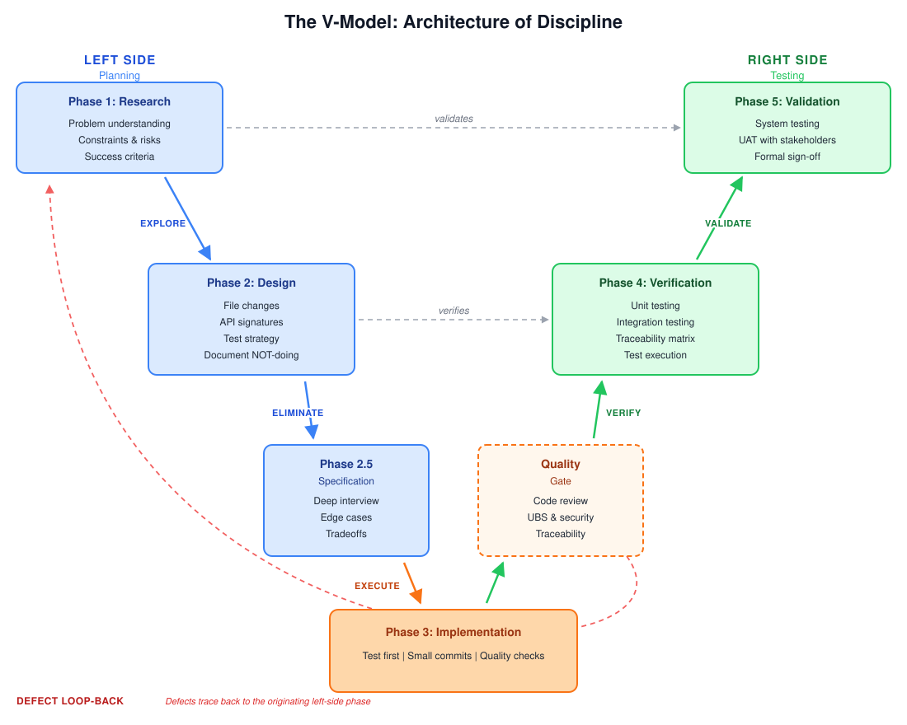

<p align="center">
  
</p>

# Terraphim Skills Introduction

**Bring local search, editor synonyms, explicit learning, and authored memory
into your agent workflow.** This repository packages four Apache-2.0
instruction skills and documents direct or custom routes for Cursor, Kimi Code,
AutoClaw, ZCode, Hermes Agent, skills.sh, and Claude Code. A Grok Build
marketplace submission is under review.

[v0.2.7 release details](docs/distribution.md)
· [Choose an agent](#install-in-your-agent)
· [Try the CLI workflow](docs/cli-workflows.md)
· [Review permissions](docs/permissions.md)
· [简体中文](README_CN.md)

## Start here

1. **Install the separate commands** with the [dependency guide](docs/install-dependencies.md),
   or use the Homebrew commands below. The skills do not install executables for
   you.
2. **Add the instruction skills to your agent** using a direct or custom route
   in the [host table](#install-in-your-agent). A curated marketplace listing
   has its own approval process.
3. **Try a bounded search**, then explicitly capture an authored lesson with
   the [checked example](docs/cli-workflows.md). Review the written memory
   before using it elsewhere.

The [v0.2.7 release](docs/distribution.md)
contains four skills and a Cursor integration archive under a signed tag. Its
[macOS ARM64 native qualification and independent review](docs/distribution.md#cursor-integration-release-gate)
pass for the exact release source; `productionSignoff` is
`PENDING_USER_SIGNOFF`. Automatic failure capture is unavailable. This release
and review do not establish Cursor Marketplace admission or qualify other
native platforms.

## The four skills

| Skill | Command family | Purpose |
|---|---|---|
| `terraphim-grep` | `terraphim-grep` | Search bounded local code and documentation, offline by default. |
| `terraphim-agent-learn` | `terraphim-agent learn` | Inspect failures and capture verified operational corrections. |
| `terraphim-agent-memory` | `terraphim-agent memory` | Save authored lessons, inspect saved content and source tags, and retrieve memory. |
| `terraphim-editor` | Editor UI → `terraphim-grep` | Create and swap alternatives, export synonyms and search related decisions. |

These instruction skills do not bundle CLI executables, secrets, or proprietary
skill content. They remain useful without a marketplace account. The [Cursor
setup guide](integrations/cursor/README.md) provides a read-first command and
optional integration examples. Installing the instruction plugin does not
activate MCP, hooks, rewriting, or capture; each optional action requires its
own reviewed setup and matching qualification evidence.

## Install the command dependencies

On macOS or Linux with Homebrew:

```bash
brew tap terraphim/terraphim
brew install terraphim-grep terraphim-agent
terraphim-grep --version
terraphim-agent --version
terraphim-agent learn --help
terraphim-agent memory --help
```

Homebrew versions can differ from the release used in an example. The linked
[graph search and authored-memory workflow](docs/cli-workflows.md) was checked
with Terraphim Clients 1.21.20; the guide links to the release archives and
checksums. Verify the installed versions before using it.
See the [non-technical installation guide](https://terraphim-skills.md/docs/non-technical/)
or the repository's [dependency installation](docs/install-dependencies.md) for
updates, removal, non-Homebrew installation, signature checks, and PATH
troubleshooting. The skills never install dependencies automatically.

## Install in your agent

The routes below describe installation methods, not v0.2.7 host acceptance.
The guide's historical v0.2.4 examples cover a three-skill pack; they do not
qualify the current four-skill release on non-Cursor hosts. The macOS ARM64
Cursor native review passes, with production sign-off still pending.

| Host | Direct or custom route | Curated status |
|---|---|---|
| Cursor | [Copy the repository locally](#local-cursor-installation). | Prior submission recorded; public listing unverified. |
| Kimi Code | Install the repository or add [`marketplaces/kimi.json`](marketplaces/kimi.json) as a custom marketplace. | Direct route documented; no curated claim. |
| AutoClaw | Import one checksummed ZIP per skill from the [release](docs/distribution.md) through **Skills & Connectors → Skills → Create → Add skill file**. | Local import documented; external catalog review is separate. |
| ZCode | Add [`marketplaces/zcode.json`](marketplaces/zcode.json) as a personal marketplace and install `terraphim-skills-intro`. | Curated listing awaits maintainer review. |
| Hermes Agent | Add `terraphim/terraphim-cursor-plugin` as a tap, then inspect and install the four skills. | Tap route documented; no curated claim. |
| skills.sh | Run `npx skills add terraphim/terraphim-cursor-plugin`; `DISABLE_TELEMETRY=1` opts out of anonymous telemetry. | Direct repository route documented. |
| Claude Code | Add this repository as a marketplace, then install the plugin as shown below. | Custom marketplace route documented. |
| Kilo | Integration is being prepared. | Catalog admission and actual Kilo installation unqualified. |
| Grok Build | The submission pins a signed release; see the [distribution guide](docs/distribution.md). | Awaiting maintainer review. |

Claude Code commands:

```text
claude plugin marketplace add terraphim/terraphim-cursor-plugin
claude plugin install terraphim-skills-intro@terraphim-skills
```

Availability in a host's curated public marketplace is separate from direct or
custom installation. See the [distribution guide](docs/distribution.md) for exact
install, update, discovery, and removal steps and current publication status.

## Local Cursor installation

For local development, copy this repository into:

```text
~/.cursor/plugins/local/terraphim-skills-intro
```

Cursor 3.20 rejects a symlink when its resolved target is outside
`~/.cursor/plugins/local`, so use a real directory:

```sh
cp -R /path/to/terraphim-cursor-plugin \
  ~/.cursor/plugins/local/terraphim-skills-intro
```

Reload Cursor, open **Customize**, and confirm that all four skills appear.

## Use both command-line tools

[Search with an editor-exported synonym graph, then save and read an authored
lesson](docs/cli-workflows.md). The example includes a real exported Risk/Concern
graph, a clean public corpus, a baseline search and saved JSON outputs:

```sh
terraphim-grep Concern --search-only --haystack all \
  --paths ./corpus --thesaurus ./risk-concern.knowledge-graph.json --json -n 3

terraphim-agent --format json memory capture \
  --content 'Risk requires a Decision: approve a second supplier as the mitigation.' \
  --provenance-tag 'public-project-brief' > captured-memory.json
memory_id="$(python3 -c 'import json; print(json.load(open("captured-memory.json"))["memory_id"])')"
terraphim-agent memory show "$memory_id" --json
```

Create the corpus and copy the graph using the linked guide before running these
commands. The memory capture writes to the current user's OS-local store,
independent of the current working directory; exporting a search graph does not
select a memory role or storage scope.

Read the [synonym-search walkthrough](https://terraphim.ai/how-tos/synonym-search/),
[agent memory walkthrough](https://terraphim.ai/posts/cold-start-tax-agentic-memory/)
and [learning/hooks walkthrough](https://terraphim.ai/posts/native-hook-support/)
for the complete flows.

## Example requests

- “Use Terraphim Grep to find the authorization callback and show two lines of context.”
- “Search project learnings for an earlier failed deployment command.”
- “Save this authored lesson in local memory, then show its saved ID and content.”

The skills default to local, read-only operations. Persistent learning or memory
changes remain explicit and scoped. Review [permissions and side effects](docs/permissions.md)
before enabling writes or configured model synthesis.

## Continue with Terraphim Skills

The skills can support an engineering workflow from research through validation.
The diagram shows that method; it is not an automatic feature of this plugin.



Browse the [Community, Core, and Premium catalogue](https://terraphim-skills.md/skills/).
The public introduction contains no proprietary instructions or entitlement token.
Following a related-skill link never creates a checkout or transaction. Access and
purchase decisions remain on Terraphim's authenticated site and MCP services.

For guided setup, see the [non-technical installation guide](https://terraphim-skills.md/docs/non-technical/).
For agent integration, see the [MCP guide](https://terraphim-skills.md/docs/mcp/).
Read the [privacy policy](https://terraphim-skills.md/legal/privacy/) and
[terms of service](https://terraphim-skills.md/legal/terms/). The engineering
approach is explained in the canonical
[Disciplined Engineering for AI Systems](https://terraphim.ai/posts/disciplined-engineering-ai-systems/)
article.

## Development

```bash
python3 scripts/generate_distribution.py --check
python3 -m unittest discover -s tests -p 'test_*.py'
python3 scripts/generate_distribution.py --autoclaw-dist dist/autoclaw
```

## Licence

Apache-2.0. See [LICENSE](LICENSE).
